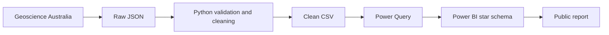

# Australian Resources and Energy Explorer

An interactive Power BI report for exploring 347 Australian operating mines by
state and commodity. The project includes a lightweight Python data pipeline,
a star schema, DAX measures and source-controlled PBIP/TMDL files.

## Live report

**[Open the interactive Power BI report](https://app.powerbi.com/view?r=eyJrIjoiZjBhZDQ2YmEtNmU2ZC00NGMwLThkYmYtMTQ1MGFjNDk1ODk0IiwidCI6IjE0NWM3YTk0LTRjMjEtNDFmNi1hYjc2LTJjM2E4NDE0MzdkZSJ9)**

## What it includes

- Australian state Shape Map with commodity-based filtering.
- Commodity selector covering 13 reporting groups.
- KPI cards, commodity ranking and mine-level details.
- Dynamic selected-region label and reset bookmark.
- Python validation and raw-to-clean transformation.
- PBIP, PBIR and TMDL source files.

## Architecture



## Data model

- `FactMine`: one row per operating mine.
- `DimRegion`: state and territory dimension.
- `DimCommodity`: simplified commodity dimension.
- Single-direction, one-to-many relationships from dimensions to `FactMine`.

Key measures include `Operating Mines`, `Commodities Selected`, `Top Commodity`,
`Map Mine Count` and `Selected Region Label`.

## Run locally

```bash
python3 scripts/prepare_mines.py
```

Then open `Australian Resources and Energy Explorer.pbip` in Power BI Desktop.
Update the `FactMine` Power Query source to your local
`data/clean/operating_mines.csv` path and apply changes.

## Data quality checks

The Python pipeline checks required fields, unique mine identifiers, nulls,
recognised state codes and coordinate ranges. It produces 347 clean records.

## Data source and licence

Data source:
[Geoscience Australia Australian Operating Mines ArcGIS service](https://services.ga.gov.au/gis/rest/services/AustralianOperatingMines/MapServer),
layer `Operating_Mines`.

Attribution: **© Commonwealth of Australia (Geoscience Australia) 2026**. The
source data is released under the
[Creative Commons Attribution 4.0 International licence](https://creativecommons.org/licenses/by/4.0/).

Repository code is available under the [MIT License](LICENSE). Source data and
Power BI components retain their respective licences.

## Notes

- Mine count represents operating sites, not production, revenue or resource size.
- Indian Ocean Territories remains in the national total but is excluded from
  the built-in state map.
- The project uses only public data and contains no employer or client material.
