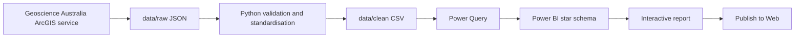

# Australian Resources and Energy Explorer

An interactive Power BI portfolio report for exploring Australian operating
mines by state and commodity. It combines a reproducible Python cleaning step,
a compact star schema, DAX measures, PBIP/TMDL source control and a public
Power BI report.

**[Open the interactive report](https://app.powerbi.com/view?r=eyJrIjoiZjBhZDQ2YmEtNmU2ZC00NGMwLThkYmYtMTQ1MGFjNDk1ODk0IiwidCI6IjE0NWM3YTk0LTRjMjEtNDFmNi1hYjc2LTJjM2E4NDE0MzdkZSJ9)**

## Why this project

The project is designed as a focused interview talking point for BI Developer,
Power BI Developer and BI Engineer roles in Australia's resources sector. It
shows both the report-consumption layer and the lightweight engineering work
behind it, without pretending that mine count represents production volume or
economic value.

## What the report answers

- How many operating mines are represented nationally or in a selected state?
- Which commodities have the largest number of operating mine sites?
- Which states contain mines for a selected commodity?
- Which commodity is most common in the current filter context?
- Which mine records contribute to the selected result?

## Delivered features

- Native Power BI Shape Map of Australian states for public-embed compatibility.
- Compact multi-button commodity selector covering 13 reporting groups.
- Cross-filtering between state, commodity, KPI, ranking and detail visuals.
- Dynamic selected-region label with `Australia` as the unfiltered state.
- Reset bookmark for returning the report to its default view.
- Responsive KPI measures for operating mines and leading commodity.
- Public CC BY 4.0 data with visible in-report attribution.
- PBIP/PBIR/TMDL files suitable for source control and technical review.
- Re-runnable Python cleaning and data-quality checks.

## Architecture



## Data model

The fact table grain is one row per operating mine.

- `FactMine`: mine identifier, name, state, commodity group and coordinates.
- `DimRegion`: one row per state or territory represented in the source data.
- `DimCommodity`: one row per simplified reporting commodity.
- Relationships: single-direction, one-to-many from each dimension to
  `FactMine`.

The mine fact acts as the region-to-commodity bridge. No bidirectional or
many-to-many relationship is required.

## Key DAX measures

- `Operating Mines`: distinct mine-site count.
- `Commodities Selected`: number of commodity dimension values in filter context.
- `Top Commodity`: highest-count commodity with deterministic alphabetical
  tie-breaking.
- `Map Mine Count`: converts blank map results to zero for colour formatting.
- `Selected Region Label`: returns a state, `Multiple regions`, or `Australia`
  according to filter context.

The measure definitions are available in
[`FactMine.tmdl`](Australian%20Resources%20and%20Energy%20Explorer.SemanticModel/definition/tables/FactMine.tmdl).

## Data engineering and quality controls

[`scripts/prepare_mines.py`](scripts/prepare_mines.py) performs a small,
repeatable raw-to-clean transformation using only the Python standard library.
It checks:

- required source fields;
- non-empty input;
- unique mine identifiers;
- non-null required values;
- recognised state codes; and
- valid latitude and longitude ranges.

It also standardises state names and maps detailed publisher commodity groups
into 13 report-friendly categories.

Run the pipeline from the repository root:

```bash
python3 scripts/prepare_mines.py
```

Expected output: 347 records in `data/clean/operating_mines.csv`.

## Reproducing the report

1. Clone the repository on a Windows machine with Power BI Desktop installed.
2. Run `python3 scripts/prepare_mines.py`.
3. Open `Australian Resources and Energy Explorer.pbip`.
4. In Power Query, update the `FactMine` CSV source path to your local
   `data/clean/operating_mines.csv` file.
5. Apply changes and verify the unfiltered operating-mine total is 347.

The checked-in PBIP currently contains the original local CSV path because
Power Query file sources are machine-specific. No credentials or secrets are
stored in the repository.

## Source and licence

Operating-mine data is sourced from the
[Geoscience Australia Australian Operating Mines ArcGIS service](https://services.ga.gov.au/gis/rest/services/AustralianOperatingMines/MapServer),
layer `Operating_Mines`.

Attribution: **© Commonwealth of Australia (Geoscience Australia) 2026**.
The source service states that the product is released under the
[Creative Commons Attribution 4.0 International licence](https://creativecommons.org/licenses/by/4.0/).

Repository code is provided under the [MIT License](LICENSE). Source data and
Microsoft/Power BI components retain their respective licences and are not
relicensed by the repository MIT licence.

## Design choices and trade-offs

- Mine count is used because the public source is site-level data; it is not a
  proxy for production, revenue or resource size.
- A native Shape Map replaced the initial custom-visual concept because the
  portfolio report needed to work in anonymous Publish-to-Web embedding.
- Indian Ocean Territories remains in the data model and national total but is
  excluded from the built-in state map.
- The project intentionally uses a lightweight local pipeline rather than
  Fabric, Snowflake or orchestration infrastructure that would exceed the MVP.

## Future work

- Add an openly licensed historical export-value trend.
- Parameterise or automate the Power Query source path.
- Add automated PBIP/TMDL validation in CI.
- Add incremental ingestion and orchestration in Microsoft Fabric.
- Add a custom geographic inset for Indian Ocean Territories.

## Repository structure

```text
Australian Resources and Energy Explorer.pbip
Australian Resources and Energy Explorer.Report/
Australian Resources and Energy Explorer.SemanticModel/
data/
  raw/ga-operating-mines.json
  clean/operating_mines.csv
docs/project-plan.md
scripts/prepare_mines.py
```

## Disclaimer

This is an independent portfolio project. It does not use employer or client
data, code, branding or screenshots, and it is not affiliated with or endorsed
by Geoscience Australia or any mining company.
